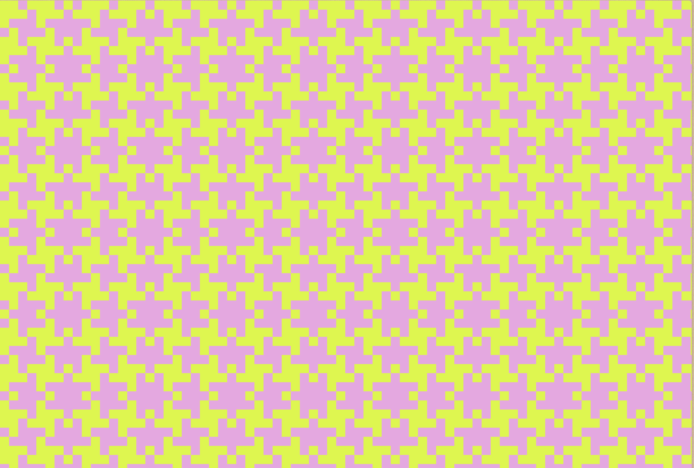
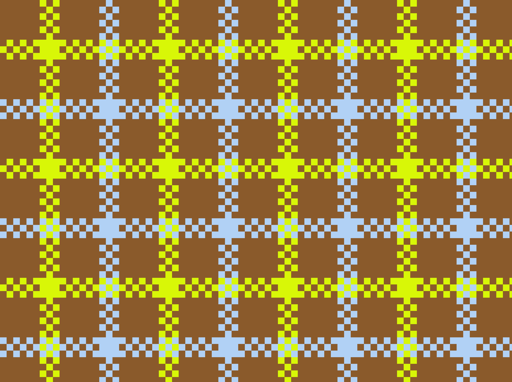
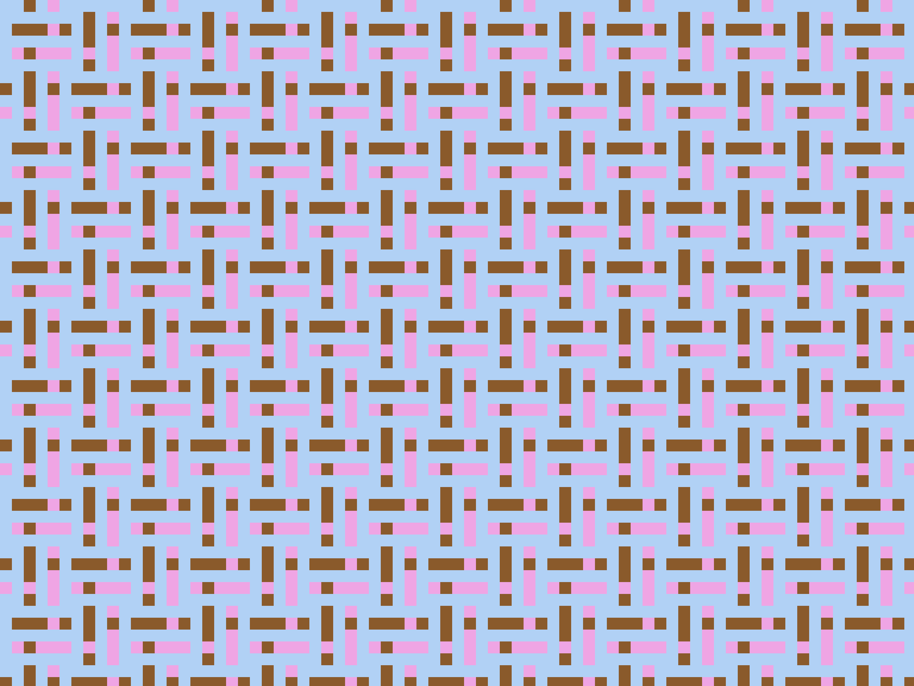
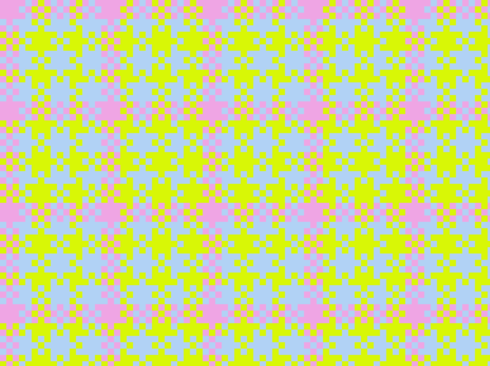
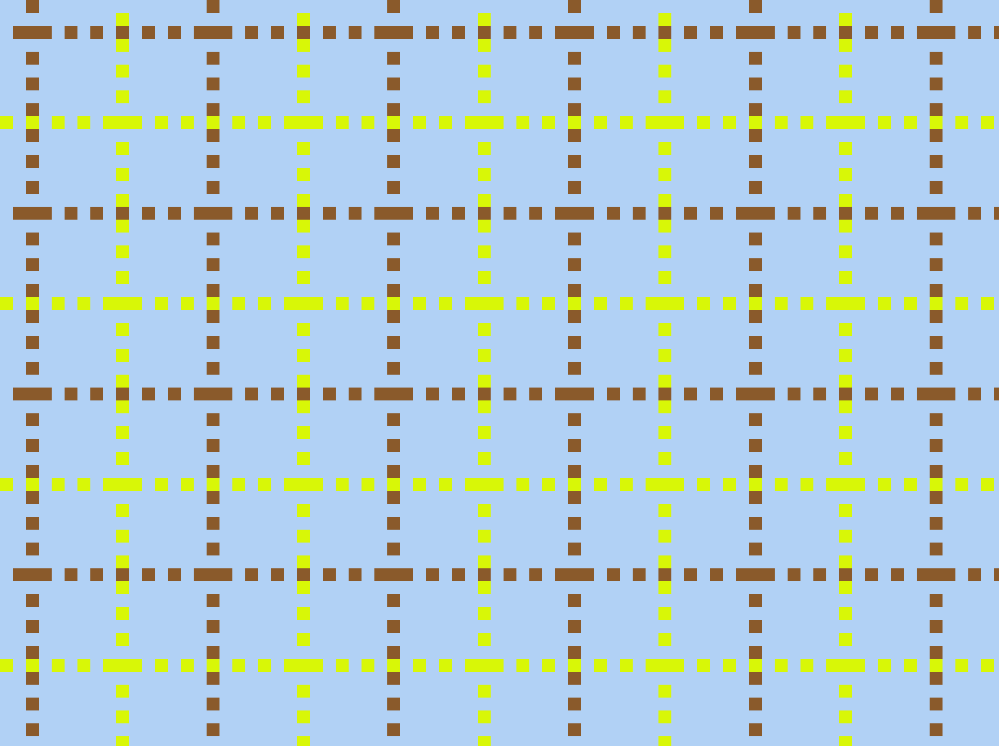
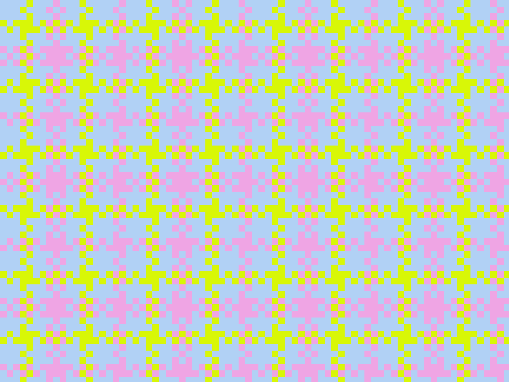
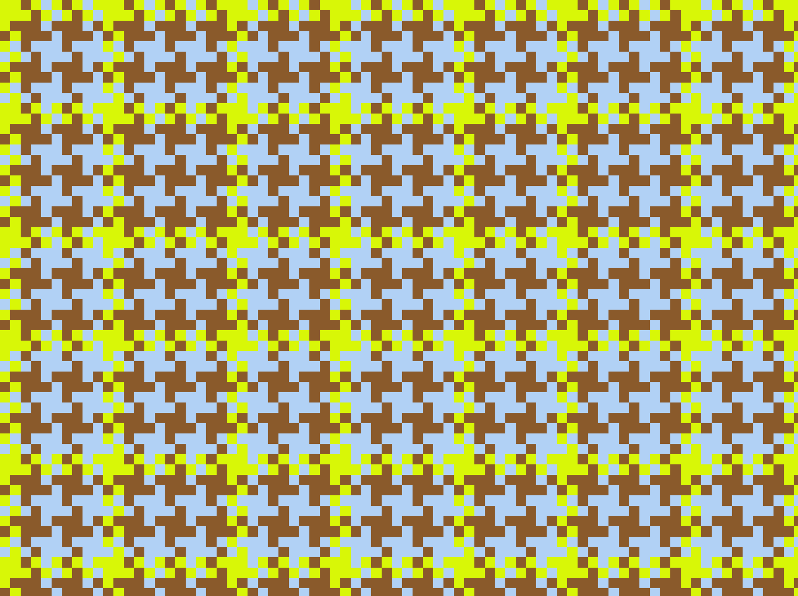

## **Código y links**

- [Herramienta online](https://martucol.github.io/telar-euclidiano/)
- [Algoritmo generativo, protector de pantallas](https://martucol.github.io/telar-euclidiano/auto)
- [Link de descarga en ZIP](https://github.com/martucol/telar-euclidiano/archive/refs/heads/main.zip)
- [Repositorio completo](https://github.com/martucol/telar-euclidiano)


---

## Bibliografía

- Abregú, E. (2025). *Código que suena: Coding Creativo y Pensamiento Sonoro con Pure Data*. Cap. 2, Secuenciación: secuenciador euclidiano y generador de acentos euclidianos. https://ezequielabregu.github.io/code-that-sounds-es/chapters/sequencing.es.html
- Albers, A. (1965). *On Weaving*. Wesleyan University Press.
- Alberti, D. J. (2023). *Lliklla*. https://www.diegoalberti.net/artworks/clx82y4jy1aka07lurtr47qun
- Demaine, E. D., Gómez-Martín, F., Meijer, H., Rappaport, D., Taslakian, P., Toussaint, G. T., Winograd, T. y Wood, D. R. (2009). The distance geometry of music. *Computational Geometry: Theory and Applications*, 42(5). https://erikdemaine.org/papers/DeepRhythms_CGTA/paper.pdf 
- Toussaint, G. (2005). The Euclidean Algorithm Generates Traditional Musical Rhythms. *Proceedings of BRIDGES: Mathematical Connections in Art, Music and Science*, 47–56. https://cgm.cs.mcgill.ca/~godfried/publications/banff.pdf
- van de Seyp, V. (2023). *Overshot Pattern Tool*. MIT Media Lab. https://veravandeseyp.com/projects/overshot-pattern-tool/

---

## Anexos

### Anexo A. Pseudocódigo 1D

```js
Variables:

  nHilos = 100 // cantidad de hilos
  GROSOR = 4 // px por hilo
  ALTO = 100 // px alto total 
  nColores = 2 // cant colores q alternan
  nMin  = 2 // minimo rango de pasos secuencia
  nMax  =  13 // max rango de pasos secuencia
  MARGEN = 30 // margen de espacio a los costados del patron generado
  PALETA = ['#cadcff', '#efa5e4', '#d8f707', '#8a5a2b'];
  FONDO = '#efe6d2';
  TEXTO = '#585050';
  SECUENCIAHILOS = []
  Indice = 0


Algoritmo:

- Euclides (k, n) :
		Devuelve un array de n posiciones, con la distribucion euclidiana de 1s y 0s para k cantidad de 1s
- NuevoPatron () :
		COLORES[] = elegir aleatoriamente nColores cant de items dentro de la lista PALETA
		n = elegir aleatoriamente el valor de n entre nMin y nMax
		k = elegir aleatoriamente el valor de k entre 1 y ( n - 1  )
		SECUENCIAEUCLIDES = obtener secuencia Euclides(k,n)
		colorActual = 0            
  
- Dibujar(secuencia):
		Pintar FONDO en todo el canvas
		Para cada Item de secuencia:
			dibujar un rectángulo de GROSOR px de ancho y ALTO px de alto
			en x = MARGEN + Indice del Item * GROSOR, y = MARGEN
			con color = valor del Item
		Debajo, dejando MARGEN px, escribir (k, n) como referencia

Inicio:
	NuevoPatron()

Bucle:
	// pasar de 1000101000 a 1000 => color uno 10 => color 2, es decir: 
	Indice = 0 
	Mientras Indice < nHilos
		si SECUENCIAEUCLIDES[ Indice % n ] == 1 
			 =>	colorActual =  (colorActual + 1) % nColores
		SECUENCIAHILOS[Indice] = COLORES[colorActual]
		Indice +1 , hasta que Indice == nHilos
	Cuando Indice == nHilos, salir del bucle, y Dibujar(SECUENCIAHILOS) 

```

### Anexo B. Pseudocódigo versión final

```js
Parámetros iniciales:

  grosorHilo = 16 // px por "hilo". la cantidad de "hilos" horizontales y verticales se calcula a partir del alto / ancho de pantalla
  nColores = 3 // se eligen aleatoriamente de la paleta, 1 para el acento, el resto para la base
  nMin = 3 // minimo valor para n, como minimo 3 porque k tiene que ser al menos 2 para que haya acento
  nMax = 29 // maximo valor para n
  tiempoHilo = 50 // ms que tarda cada hilo en dibujarse
  tiempoEspera = 3000 // ms de pausa entre un patrón y el siguiente
  paletaColores = ['#b1d1f5', '#efa5e4', '#d8f707', '#8a5a2b'];
  colorFondo = '#efe6d2';
  anchoPantalla // ancho pantalla en px
  altoPantalla // alto pantalla en px
  cantHilosUrdimbre = anchoPantalla / grosorHilo, redondeado hacia arriba
  cantHilosTrama = altoPantalla / grosorHilo, redondeado hacia arriba

Variables:

  coloresBase = [] // los colores base elegidos de la paleta para este patrón
  colorAcento // color de acento elegido de la paleta para este patron
  n // cantidad de pasos de la secuencia, elegido aleatoriamente entre nMin y nMax
  k // cantidad de 1s repartidos en los n pasos, elegido aleatoriamente entre 2 y n - 1
  a // cantidad de acentos repartidos sobre los k unos, elegido aleatoriamente entre 1 y k - 1
  secuencia = [] // una vuelta del patrón, n pasos con 0, 1 (k) y 2 (acento). ej: E(3,8) con E(1,3) = 20010010
  urdimbre = [] // secuencia de color de cada hilo vertical, de izquierda a derecha, de cantHilosUrdimbre posiciones
  trama = [] // secuencia de color de cada hilo horizontal, de arriba hacia abajo, de cantHilosTrama posiciones
  fase // en qué parte de la animación de tejido estamos: 'urdimbre' | 'trama' | 'espera'
  hiloActual // índice del hilo que se está dibujando ahora en la fase actual
  t0 // momento en que arrancó el hilo actual (o la espera), para calcular porcentajeHiloDibujado


Algoritmo:

  - InicializarPatron () :
      colores = elegir aleatoriamente nColores cant de items dentro de la lista paletaColores
      colorAcento = posicion 0 de colores
      coloresBase = posicion 1 en adelante de colores
      n = elegir aleatoriamente el valor de n entre nMin y nMax
      k = elegir aleatoriamente el valor de k entre 2 y ( n - 1 )
      a = elegir aleatoriamente el valor de a entre 1 y ( k - 1 )
      secuenciaInicial = SecuenciaEuclides(k, n)
      secuencia = AgregarAcento(secuenciaInicial, k, a)
      urdimbre = CalcularSecuenciaColores(cantHilosUrdimbre)
      trama = CalcularSecuenciaColores(cantHilosTrama)
      fase = 'urdimbre'
      hiloActual = 0
      t0 = tiempo actual en ms

  - SecuenciaEuclides (k, n) :
      Devuelve un array de n posiciones, con la distribucion euclidiana de 1s y 0s para k cantidad de 1s
      // fórmula modular: en el paso i va un 1 si (i * k) % n < k, si no un 0
      // E(3,8) = 10010010

  - AgregarAcento (secuenciaPrincipal, k, a) :
      // secuencia principal E(k,n), secuencia acento E(a,k): el acento se reparte sobre los k unos
      SecuenciaAcento = SecuenciaEuclides(a, k)
      indiceK = 0 // cuántos 1 de la secuencia principal van recorridos
      Para cada Item de secuenciaPrincipal:
        si Item == 1 => si SecuenciaAcento[indiceK] == 1 => Item = 2
                        indiceK + 1
      Devuelve la secuenciaPrincipal con los acentos ubicados

  - CalcularSecuenciaColores (cantTotalPasos) :
      // 1 → siguiente color base · 2 → color acento · 0 → mantiene el color anterior
      secuenciaColores = []
      indiceColorBase = 0 // posición dentro de coloresBase
      colorActual // el color que se le asigna a cada posicion.
      indice = 0
      Mientras indice < cantTotalPasos
        paso = secuencia[ indice % n ]
        si paso == 1:
          indiceColorBase = (indiceColorBase + 1) % coloresBase.longitud
          colorActual = coloresBase[indiceColorBase]
        si paso == 2:
          colorActual = colorAcento
        secuenciaColores[indice] = colorActual
        indice + 1, hasta que indice == cantTotalPasos
      Devuelve secuenciaColores


Inicio:
	Pintar colorFondo en todo el canvas // sucede una unica vez, al iniciar. 
	InicializarPatron()


Bucle (cada frame):
	ahora = tiempo actual en ms
	si fase == 'espera':
		si pasaron tiempoEspera ms desde t0:
			InicializarPatron()
		si no:
			no dibujar nada y terminar este frame
	porcentajeHiloDibujado = min( (ahora - t0) / tiempoHilo , 1)
	si fase == 'urdimbre':
		// URDIMBRES: crecen de arriba hacia abajo
		dibujar un rectángulo de grosorHilo px de ancho y (altoPantalla * porcentajeHiloDibujado) px de alto
		en x = hiloActual * grosorHilo, y = 0
		con color = urdimbre[hiloActual]
	si fase == 'trama':
		// TRAMAS: crecen de izquierda a derecha, tafetán
		// solo se pinta en los cruces donde la trama va adelante
		// cada cruce es un cuadrado de grosorHilo px de lado
		cantCrucesADibujar = (cantHilosUrdimbre * porcentajeHiloDibujado), redondeado hacia abajo
		Para cada urdimbre i, desde 0 hasta cantCrucesADibujar:
			si (hiloActual + i) % 2 == 0:
				no dibujar la trama, la urdimbre va adelante
			si no:
				dibujar un cuadrado de grosorHilo px de lado
				en x = i * grosorHilo, y = hiloActual * grosorHilo
				con color = trama[hiloActual]
	si porcentajeHiloDibujado == 1: 
  // si ya se completó este hilo, pasar al siguiente
		hiloActual + 1
		t0 = ahora
		si fase == 'urdimbre' y hiloActual == cantHilosUrdimbre:
			fase = 'trama', hiloActual = 0
		si fase == 'trama' y hiloActual == cantHilosTrama:
			fase = 'espera'
```


### Anexo C. Diagrama de flujo
[link para vista dinamica](https://martucol.github.io/telar-euclidiano/diagrama)


### Anexo D. Capturas



*E(4,9), sin acentos*


*E(4,9) con acento E(3,4)*


*E(12,15) con acento E(6,12)*


*E(6,16) con acento E(1,6)*


*E(15,21) con acento E(12,15)*


*E(8,19) con acento E(4,8)*


*E(11,22) con acento E(2,11)*


